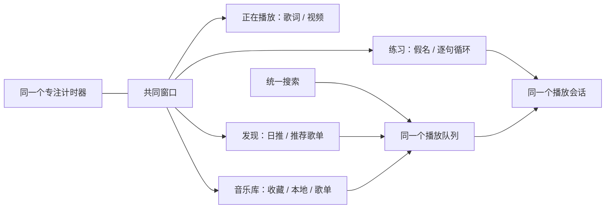

# 澄音：个人播放器的下一步

状态：准备方案，未实施、未部署。2026-10-20。

v0.1.1 只发布播放记录同步。本文中的新导航、搜索、跨来源音乐库、视频、Hi-Fi 和跟唱均不是当前功能。阶段没有承诺发布日期，先做可撤销原型和实测，再决定是否进入主版本。

## 产品主旨

一个打开就能听歌、想唱就能练习、学习时安静陪伴的 Windows 原生播放器。网易云和 B站是第一批来源，之后可以增加其他平台及本地文件。项目开源，但优先服务清楚的个人使用场景，不以功能数量为目标。

保留当前封面配色、透明感图标、柔和歌词、轻量频谱和一言。最常用的动作一两步完成。专业能力放在需要它的地方，避免一个设置页塞进所有选项。

建议先补的基础能力：可靠搜索、无缝播放、媒体键、队列撤销、失效音源提示、本地音乐和数据导出。这些比添加大量视觉仪表更能改善每天的使用。

## 页面与共同结构

顶层仅四个去处：**正在播放、发现、音乐库、练习**。搜索是共同入口，视频是正在播放页的一种呈现，不为每个平台再造一套导航。发现页初期只显示已登录来源的日推与收藏入口，不引入内容瀑布流或社交信息流。

| 页面 | 核心内容 | 有意收起的功能 |
| --- | --- | --- |
| 正在播放 | 保留左封面右歌词，视频模式按画面比例布局 | 队列侧栏、来源、输出细节按需展开 |
| 发现 | 日推、推荐歌单、继续听 | 平台筛选放在顶部小入口，不复制平台首页 |
| 音乐库 | 本地混合歌单、平台歌单、喜欢与历史 | 导入导出、批量编辑在上下文操作里 |
| 搜索结果 | 曲目、视频、歌单，来源明确 | 同录音的备选来源折叠，不直接合并翻唱、现场、伴奏 |
| 跟唱练习 | 当前句、假名、上一句和下一句、循环区间 | 录音、音高轨迹与偏移校正在后续工具抽屉里 |

全局底部保留同一个专注胶囊：状态、时间、开始/休息。页面切换不重建计时器，不暂停音乐，不增加第二份学习计数。全屏视频仍有低对比计时入口，避免覆盖字幕。非播放页使用小播放条，沉浸播放页不再重复显示它。

宽屏：紧凑左侧导航，正文居中并限制最大宽度。中等窗口：导航收为图标，悬停有说明。窄窗口：可展开导航，单列内容，底部播放和专注区域不会挤压成不可点击的按钮。离开页面后保留筛选、滚动和手动浏览歌词的位置。

## 视觉约定

采用“磨砂糖纸＋耳机小猫”的方向，可爱集中在标志、选中状态和少量空状态插图。不给每个按钮加猫耳，也不把所有页面铺满装饰。

| Token | 初始参考值 | 用途 |
| --- | --- | --- |
| 夜莓 | `#211C26` | 深色底，不压成纯黑 |
| 奶白 | `#FFF5EE` | 主文字与浅色方案 |
| 樱粉 | `#E7A9BA` | 喜欢、选中与品牌强调 |
| 浅桃 | `#F1C2AA` | 温暖辅助高光 |
| 灰紫 | `#B9A9C8` | 次级提示 |
| 鼠尾草 | `#AEBEB2` | 可选封面配色平衡 |

不采用蓝色品牌色。封面取色继续保留，但限定饱和度和文字对比度，避免遇到明亮封面就看不清。图标保持统一线宽，视觉尺寸约 18–20 DIP，实际点击区域至少 32 DIP，关键触控动作更大。透明只是视觉语言，悬停、键盘焦点和高对比模式必须可辨认。

标题可用系统已有的圆润日文字体 `Yu Gothic UI`，中文正文采用 `Microsoft YaHei UI`，数字使用等宽数字特性。全部设置系统字体回退，不在安装包随意附带商业字体。字号层级先按标题 26、正文 14、辅助 12 DIP 设计，再以原生截图校正。

动效只表达状态和空间关系：页面淡入与轻位移约 160–220 ms，喜欢图标一次轻弹，封面背景维持低速漂移。页面列表不永久逐项动画。尊重系统减少动画设置。背景用预处理图像和原生合成位移，避免每帧做封面取色或模糊。

设计自检：一开始考虑所有入口都做透明浮动胶囊，但会让层级变乱。因此只保留全局播放/专注区域的胶囊感，页面内容使用轻分组和留白。先用三页原型检验一致性，再做其他页面。

## 来源与音乐库

保留 WinUI 3 / C#。当前 Node 服务继续负责网易云适配，Python 仍是按需启动的可选分析工作进程。先提取边界，不因“完整播放器”重新写一遍音频与计时核心。

建议的对象和职责：

| 对象 | 关键职责 |
| --- | --- |
| `SourceTrackRef` | `provider + remoteId + variant`，B站还含分 P 标识 |
| `CatalogItem` | 展示元数据、录音版本和来源引用，不能仅凭标题判定同曲 |
| `LibraryEntry` | 本地收藏与混合歌单的条目，平台删除不直接删除本地条目 |
| `QueueEntry` | 独立队列 ID、来源引用和播放意图，同曲可重复出现 |
| `PlaybackSession` | 唯一当前播放、实际输出计时、切换/暂停/结束事件 |
| `FocusSession` | 独立单调计时和学习记录存储，不依赖任何页面生命周期 |
| `ProviderCapabilities` | 查询搜索、日推、视频、歌词、点赞和上报是否受支持 |

适配器先覆盖 `Search / Resolve / GetLyrics / GetPlaylists / GetRecommendations`，写操作和播放上报独立声明。统一界面按能力展示，不让 B站缺失的功能出现为永久报错按钮。搜索输入防抖，旧请求取消，结果分批显示，单个平台超时不阻塞其他平台。

混合歌单保存在本地，导出的是歌曲引用和用户编辑的信息，不是歌曲文件或 Cookie。平台歌单保持平台语义，不能把 B站条目假写入网易云歌单。自动匹配只给候选和来源标识，优先保留用户选择的录音版本，失效时再建议替代，不偷偷切到翻唱或现场版。

将来引入本地数据库时优先评估 SQLite，但本次不迁移现有 JSON。迁移必须先备份、使用版本号、保持可回滚和幂等，先复制校验再切换。学习累计值绝不能因为导入同一备份而叠加两次。

播放记录按实际播放的来源上报。B站音频即使匹配到网易云歌曲、借用其封面或歌词，也不能被当成网易云播放记录。跨页面和音频/视频切换共享同一会话语义，不能重复记账。

## B站视频

优先验证原生 `MediaPlayerElement` / Media Foundation 路径，避免直接嵌入整页网页。微软文档说明了原生音视频呈现与自定义传输控件的基础能力，但这不代表已经验证 B站的分离音视频流和所有编码组合。[官方文档](https://learn.microsoft.com/en-us/windows/apps/develop/media-playback/play-audio-and-video-with-mediaplayer)

独立小原型需要验证：公开视频分 P、分离音视频同步、拖动后同步、链接过期重取、硬件解码、1080p 播放与音频模式切换。音视频共用一个时钟，不能让 NAudio 和另一个播放器同时发声。离开视频模式后明确停止视频解码或切到音频源，不能只把视频控件藏起来。目标音频连续性要测，不预先承诺无缝切换。

若原生路径不能覆盖代表性媒体，再比较 libmpv / FFmpeg 路径的功能、许可证、包大小与进程占用。它们是待评估备选，本次未安装。视频标题、作者和视频封面保持来源真实，不再默认用不相关音乐封面伪装成专辑。

## Hi-Fi：日常优先，专业能力按需展开

第一阶段先做本地 FLAC/WAV 等常用音频、无缝播放、输出设备选择，以及“音源格式”和“设备输出格式”的明确区分。当前显示解码采样率，不能直接据此宣称已原样输出。

第二阶段增加 WASAPI 独占。默认仍用共享模式，让用户听得到系统和其他应用的声音。独占设备不可用时给出可理解的回退选择，并及时释放设备。独占不自动意味着音质提升，也不等同于 bit-perfect。[Microsoft WASAPI 独占说明](https://learn.microsoft.com/en-us/windows/win32/coreaudio/exclusive-mode-streams)

| 简单选项 | 后台行为 | 需要提示的限制 |
| --- | --- | --- |
| 日常播放 | 共享输出，允许 EQ、音量和音效 | 可能经过系统混音或重采样 |
| 原样输出 | 设备支持时独占，关闭改变样本的处理 | 设备占用、格式不支持时有明确回退 |
| 跟唱练习 | 允许变速、移调与循环 | 属于处理后的音频，不显示原样输出标识 |

当前 `AudioEngine` 使用 float PCM、EQ 和限幅，因此添加一个独占开关还不能证明 bit-perfect。需要独立的未处理输出通路、格式协商、整数位深与测试音频校验。频谱可读取副本，不得改变送往设备的样本。

DSD 分清三件事：DSF/DFF 容器读取、转 PCM 兼容播放、原生 DSD/DoP 直通。DoP 是在 PCM 帧中封装 DSD 数据，不是把 DSD 音乐转换成 PCM。[DoP 1.1 标准](https://dsd-guide.com/dop-open-standard) 先验证文件与设备能力，再选择对应路径。该标准页面含历史平台背景，不用它判断现代 Windows 的整体支持状况。

DSD 直通不能套用普通 PCM 音量、EQ 或变速，也不能把 DoP 帧当普通音频送到不支持的设备。没有真实 DAC、驱动与测试样本，就不能验收直通。ASIO、DSD、ReplayGain 等高级项逐步加入输出详情，不创建一个庞大的首屏偏好设置树。

## 日语跟唱

第一版练习页：原文上方标注假名，翻译默认收起，罗马音可选。点击一句设置循环，提供句前预备时间、上一句/下一句、变速不变调及歌词时间偏移。保留原歌词和修订记录，假名允许手动改正。

优先使用来源自带的读音，否则评估本地词法分析后生成 ruby 标注。`kuroshiro` 支持日文转假名和 furigana，可作为复用已有 Node 服务的候选，其 MIT 许可仍需连同分析器和词典一起核对。[项目说明](https://github.com/hexenq/kuroshiro) 这是候选方案，没有安装依赖或宣称自动读音一定准确。

歌曲中的专有读法、当て字、人名、长音与中日文混排容易读错。句级 LRC 也不等于逐字时间戳，不能直接生成可信的逐字卡拉 OK 高亮。词级对齐应单独验证，并允许回退到句级。

建议把录音回放和 A/B 对照放在第二版，音准提示放在其后。人声分离只当可选辅助，优先支持用户提供的伴奏。暂不做“唱歌评分”，现有音高估计还不足以公平评价唱功。麦克风默认不启用，录音留在本机。参考 B站项目的具体交互和许可证，等明确链接后再评估，不复制来源不明的代码或素材。

## 性能验收先行

下面是原型验收目标，不是已测成绩。冻结当前版本作为基线，同一台机器、窗口尺寸、显示缩放、歌曲、缓存和电源状态做 A/B 测试，至少三轮。分别记录全部相关进程的 CPU、Private Bytes、工作集、GPU、解码引擎和掉音，不只观察主窗口进程。

| 场景 | 方法与初始门槛 |
| --- | --- |
| 暂停、最小化 | 预热 60 秒后采样 5 分钟，不做持续渲染或视频解码。无分析时，总 CPU 中位数争取低于 0.3%，先记录基线再确认硬件适用性 |
| 普通歌词播放 | 同素材 5 分钟三轮，相对基线 CPU/内存增长超过 10% 必须解释并复查，优先守住当前效果 |
| 歌单与搜索 | 1 万条合成记录，虚拟化和分页。正常交互反馈目标 100 ms 内，网络等待不冻结窗口 |
| 动效 | 60 Hz 下可见动画帧目标 P95 不超过 16.7 ms，后台页面不保留帧回调 |
| 连续播放 | 30 分钟无可闻掉音，1 小时内存预热后不持续增长，设备切换和断网有恢复测试 |
| 视频 | 固定编码、分辨率和帧率测试。报告硬解是否启用，不能拿纯音乐与视频直接比较 CPU |
| 分离模型 | 独立报告峰值与排队时延，限制并发，前台播放优先，不能混入普通播放占用数据 |

优化优先级：移除后台无效工作、列表虚拟化、封面缓存上限、歌词纹理复用、请求合并，再处理热点。用 WPR/WPA 定位 UI 线程和慢帧，不因语言标签直接推断性能。[WinUI 性能诊断](https://learn.microsoft.com/en-us/windows/apps/develop/performance/winui-perf)

## 实施顺序与退出条件

| 阶段 | 独立交付 | 验收后才进入下一阶段 |
| --- | --- | --- |
| A 稳定基础 | 提取播放会话/专注服务，固定性能和数据基线 | 页面切换不重置播放，不重复上报，学习记录回滚可用 |
| B 日常音乐库 | 四入口壳层、网易云搜索、混合本地队列与歌单 | 三页视觉原型确认，来源清楚，万条列表不卡 |
| C B站视频 | 独立音视频原型，再接入正在播放页 | 多种媒体样本同步通过，音频模式不隐藏解码，资源达标 |
| D 跟唱 | 假名校正、单句循环、变速 | 日语代表样本人工核验，原文不改坏，练习时仍正确计时 |
| E Hi-Fi | 无缝与独占先行，再单独验证 DSD | 真设备验收，处理链状态真实，可恢复日常模式 |
| F 更多来源 | 按适配器能力逐个添加 | 每个来源有数据/错误/退出登录和资源测试 |

B、D 的低保真设计可以先准备，C、E 的媒体实验应保持独立。不要一次重构 UI、数据库、播放引擎和账号系统。每个阶段保留可运行的旧版本和独立数据副本，批准后才更新个人安装。

## 当前准备完成度

- Concept：完成本路线图和视觉约定。
- Prototype：仅页面结构和交互草案，原生可运行原型尚未制作。
- Evaluation：已查官方媒体、独占、性能和候选假名工具资料。B站参考项目、DAC 兼容性和视频编码样本仍待确认。
- Implementation：未来功能未实施，未迁移个人数据。
- Scheduling：N/A，按用户选择阶段推进，不创建定时任务。
- Monitoring：N/A，未部署未来版本。性能门槛是后续验收方案，不宣称已有监控。

当前建议优先完成 A 和 B，再做 D 的轻量跟唱版。视频与 DSD 复杂度较高，先各自证明能稳定运行，不让它们拖慢已经好用的日常播放器。
